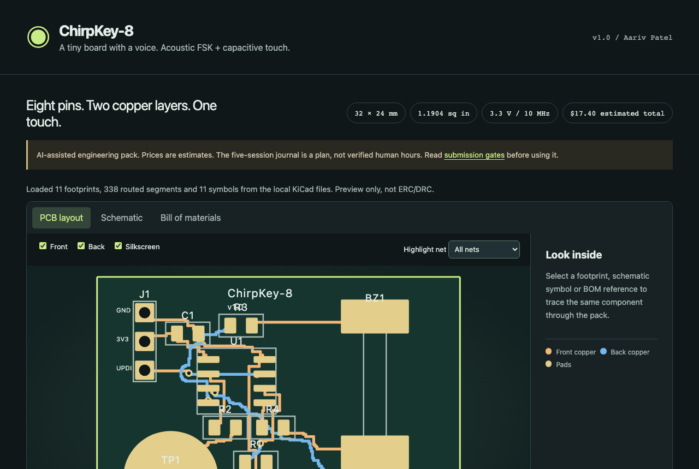
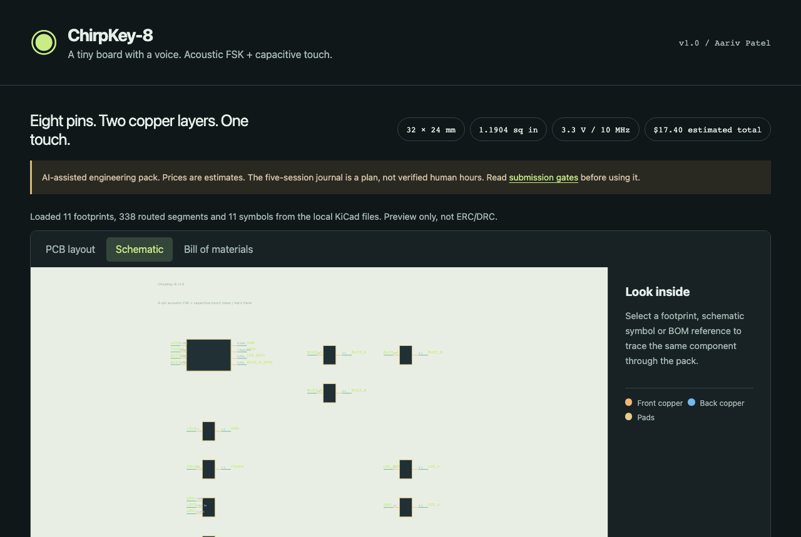
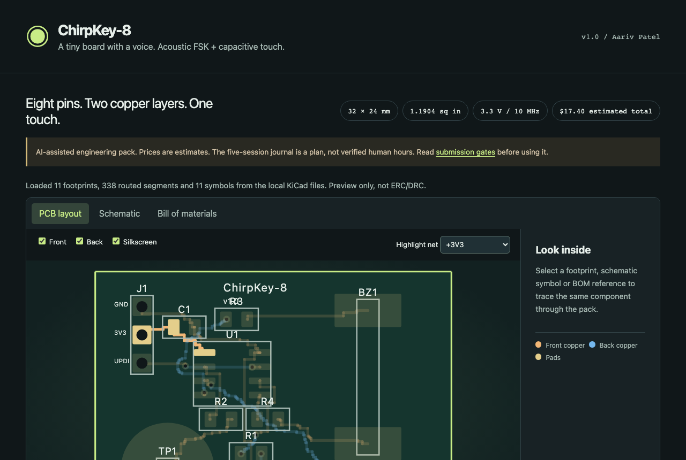
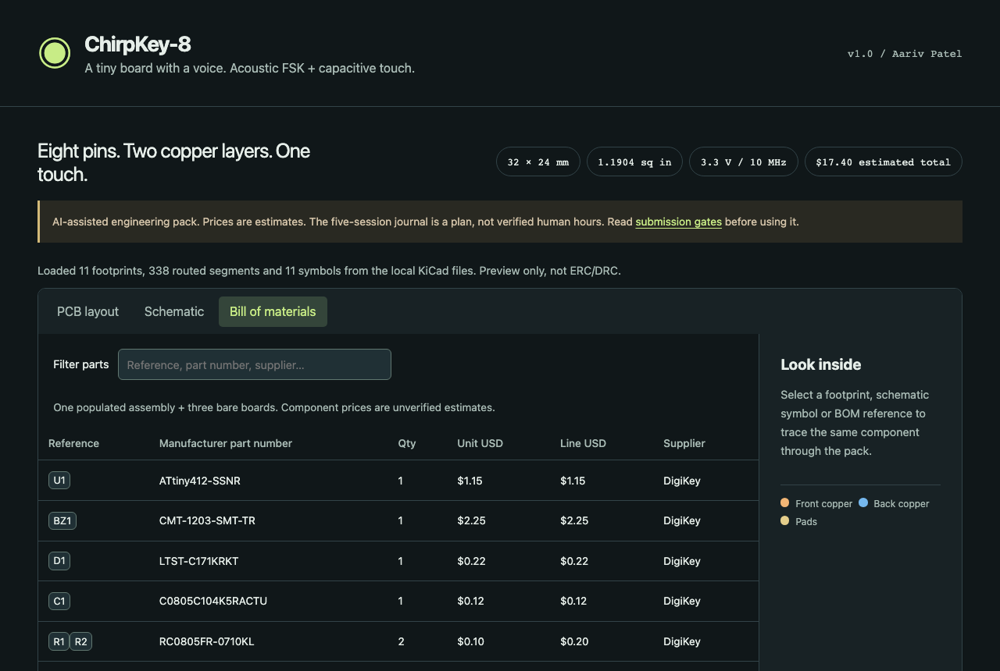

# Session 1 | Requirements and pin budget | 1.5 hours

Defined the 8-pin hardware architecture around the **ATtiny412-SSNR** (`SOIC-8`) operating from a regulated `3.3 V` supply (`10 MHz` system clock derived from the `20 MHz` internal oscillator fuse divided by `2`) so every package pin has a deterministic assignment without external multiplexers:
- `Pin 1` (`VDD`) and `Pin 8` (`GND`) decoupled via `C1` (`100 nF 50 V 0805`, `C0805C104K5RACTU`) placed adjacent to the MCU supply pins.
- `Pin 7` (`PA0 / UPDI`) routed directly to the 3-pin programming and power header `J1` (`M20-9990345`: `Pin 1 = GND`, `Pin 2 = 3V3 IN`, `Pin 3 = UPDI`) with `PA0` fuse/direction left untouched so single-wire UPDI stays usable.
- `Pin 4` (`PA1`) and `Pin 5` (`PA2`) paired as a differential push-pull bridge (`BUZZ_A_GPIO` and `BUZZ_B_GPIO`) through two `220 Ohm` `0805` series resistors (`R3` and `R4`, `RC0805FR-07220RL`) to drive the `12 x 12 mm` surface-mount piezo transducer `BZ1` (`CMT-1203-SMT-TR`) up to `6.6 Vpp` with zero idle DC bias.
- `Pin 2` (`PA6`) assigned to the solder-mask-covered `8.4 mm` copper touch electrode `TP1` via `10 kOhm` series resistor `R2` (`RC0805FR-0710KL`), `Pin 3` (`PA7`) assigned to tactile transmit switch `SW1` (`B3U-1000P`) using the internal pull-up, and `Pin 6` (`PA3`) driving red status LED `D1` (`LTST-C171KRKT`) through `10 kOhm` low-current series resistor `R1` (`RC0805FR-0710KL`).

**Total time spent: 1.5 hours**

# Session 2 | Schematic and component selection | 2.0 hours

Generated and verified the complete KiCad 8 schematic (`chirpkey8.kicad_sch`) and manufacturer part numbers (`ATtiny412-SSNR`, `CMT-1203-SMT-TR`, `B3U-1000P`, `LTST-C171KRKT`, `C0805C104K5RACTU`, `RC0805FR-0710KL`, `RC0805FR-07220RL`, and `M20-9990345`). Driving `BZ1` single-ended from one GPIO to ground limited peak-to-peak swing on a `3.3 V` supply; switching to complementary differential toggle (`PORTA.OUTTGL = PIN1_bm | PIN2_bm`) through balanced `220 Ohm` series resistors (`R3` and `R4`) doubles the effective acoustic swing across the `2400 Hz` / `3600 Hz` FSK band while limiting port peak current.

**Total time spent: 2 hours**

# Session 3 | Two-layer PCB layout and Gerber X2 export | 2.0 hours

Routed the `32 x 24 mm` (`1.1904 sq in`) two-layer board in `chirpkey8.kicad_pcb` (`338` copper segments and `10` plated `0.65 / 0.30 mm` vias across `F.Cu` and `B.Cu` at `0.25 mm` trace width and `0.20 mm` clearance). Kept `B.Cu` completely clear beneath the `8.4 mm` solder-mask-covered capacitive touch pad `TP1` (`PA6`) so ground-plane capacitance does not swamp finger touch delta, exported the 9-layer RS-274X Gerber X2 + Excellon PTH drill archive (`gerbers/` and `chirpkey8-gerbers.zip`), and paired the board with the `36 x 28 x 7.6 mm` enclosure (`cad/chirpkey8_enclosure.step` / `cad/chirpkey8_enclosure.stl`).

**Total time spent: 2 hours**

# Session 4 | Firmware and KiCanvas verification | 1.5 hours

Wrote register-level bare-metal firmware in [`firmware/chirpkey8.ino`](firmware/chirpkey8.ino) for the ATtiny412 (`10 MHz` `CLKCTRL` prescaler from `20 MHz` oscillator fuse) implementing `TCB0` complementary carrier generation, 64-sample startup baseline calibration plus slow idle tracking on `PA6` (`TP1`), `~20 ms` debounced trigger handling on `PA6`/`PA7`, and binary two-tone FSK transmission (`2400 Hz` space, `3600 Hz` mark, `16 ms` symbols MSB-first, `4 x 0x55` preamble, `0xD3` sync byte, `5`-byte payload, and `CRC-8/SMBUS` polynomial `0x07`). Confirmed independent rendering of the repository sources in KiCanvas (`https://kicanvas.org/?github=https://github.com/draarivpatel-ui/chirpkey-8`).

**Total time spent: 1.5 hours**

# Session 5 | Budget, deterministic checks and review | 1.5 hours

Compiled the deterministic Bill of Materials (`bom.csv` and `bom.json`) against DigiKey, Mouser, and OSH Park's published 2-layer area rate (`1.1904 sq in x $5.00/sq in = $5.95` for 3 bare boards). Total parts plus 3 bare PCBs come to `$11.44` (`$17.40` estimated total including `$5.00` shipping and `$0.96` tax allowances), staying inside the `$18.40` target and `$35.00` grant cap, with `tools/generate.mjs --check` and `node --test test.mjs` verifying schematic, PCB, Gerbers, drill, STEP, firmware, and BOM invariants.

**Total time spent: 1.5 hours**
