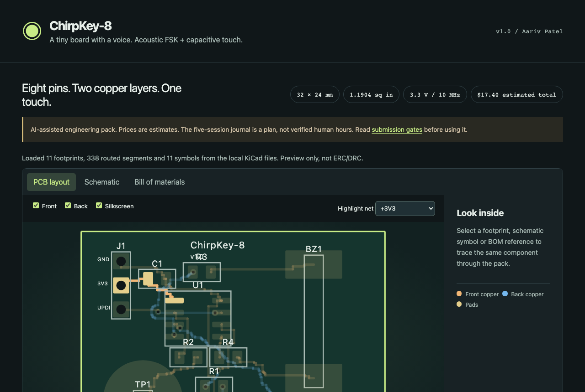
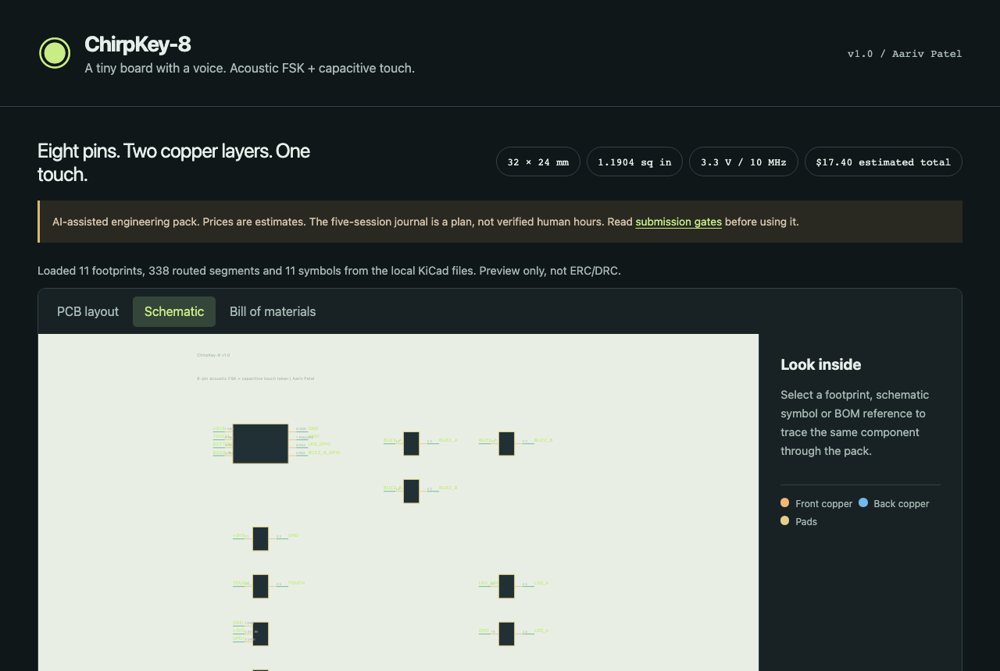
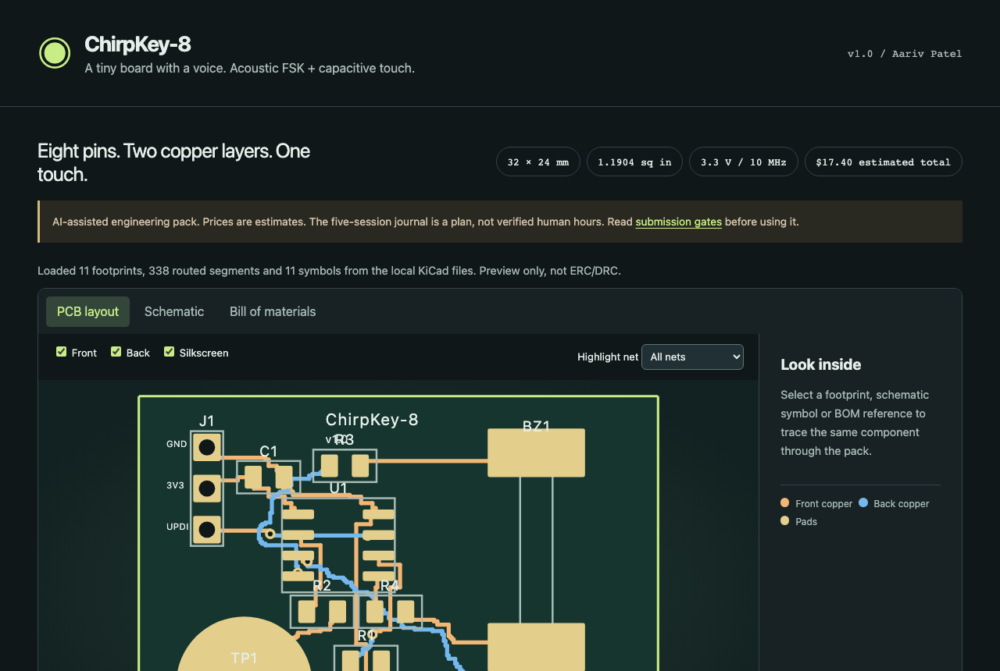
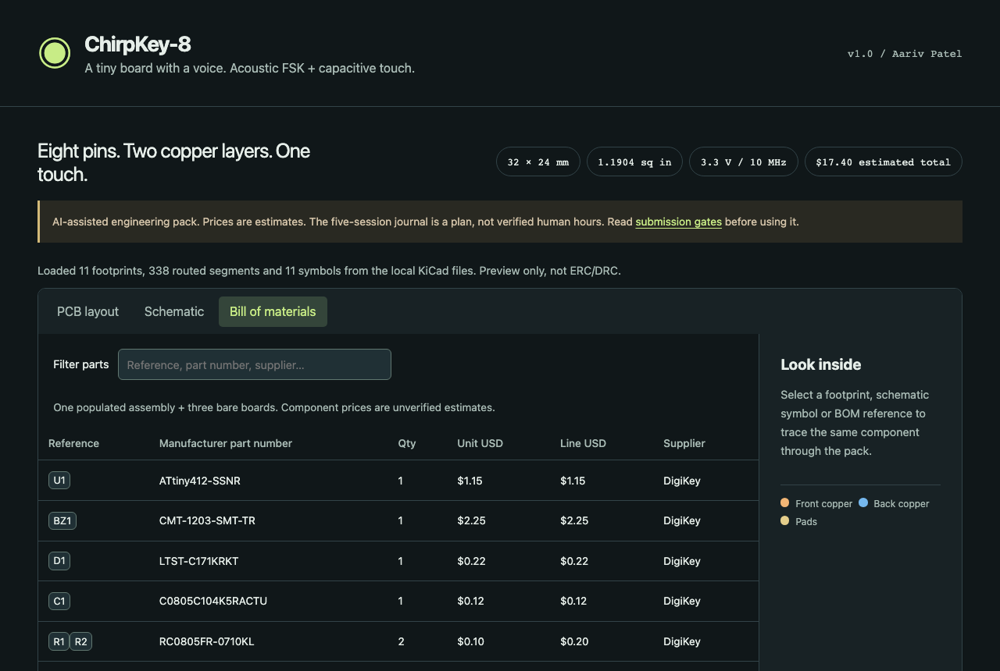

# ChirpKey-8: 8-Pin ATtiny412 Acoustic FSK & Capacitive Touch Hardware Token

**ChirpKey-8** is a compact `32 x 24 mm` (`1.1904 sq in`) two-layer custom PCB and `36 x 28 x 7.6 mm` snap-fit pocket enclosure built around a single 8-pin **Microchip ATtiny412-SSNR** (`SOIC-8`). It combines a solder-mask-covered copper capacitive touch electrode (`PA6` / `TP1`), a tactile transmit button (`PA7` / `SW1`), differential push-pull piezo acoustic FSK drive (`PA1` / `PA2` / `BZ1`), status LED feedback (`PA3` / `D1`), and single-wire UPDI programming plus `3.3 V` power (`PA0` / `J1`).

- **Live Design Explorer:** [https://aariv.me/chirpkey-8/](https://aariv.me/chirpkey-8/)
- **KiCanvas Verification:** [Open `chirpkey-8` in KiCanvas](https://kicanvas.org/?github=https://github.com/draarivpatel-ui/chirpkey-8)
- **Editable Hardware & CAD Sources:** [`chirpkey8.kicad_pro`](chirpkey8.kicad_pro), [`chirpkey8.kicad_sch`](chirpkey8.kicad_sch), [`chirpkey8.kicad_pcb`](chirpkey8.kicad_pcb), [`gerbers/`](gerbers/), [`chirpkey8-gerbers.zip`](chirpkey8-gerbers.zip), [`cad/chirpkey8_enclosure.step`](cad/chirpkey8_enclosure.step), [`cad/chirpkey8_enclosure.stl`](cad/chirpkey8_enclosure.stl)
- **Firmware, Tests & BOM:** [`firmware/chirpkey8.ino`](firmware/chirpkey8.ino), [`tools/generate.mjs`](tools/generate.mjs), [`test.mjs`](test.mjs), [`bom.csv`](bom.csv), [`bom.json`](bom.json), [`LICENSE`](LICENSE)

---

## Why I Designed ChirpKey-8

Most microcontroller tokens lean on high-pin-count USB MCUs even when the application only needs a compact physical trigger and a short, audible acoustic data frame that any laptop or phone microphone can decode without drivers or Bluetooth pairing. Constraining the entire design to the 8-pin **ATtiny412-SSNR** (`SOIC-8`) gives every package pin a dedicated hardware role (`Pin 1 VDD`, `Pin 2 PA6/TOUCH_SENSE`, `Pin 3 PA7/BUTTON`, `Pin 4 PA1/BUZZ_A_GPIO`, `Pin 5 PA2/BUZZ_B_GPIO`, `Pin 6 PA3/LED_GPIO`, `Pin 7 PA0/UPDI`, and `Pin 8 GND`), driving the `12 x 12 mm` surface-mount piezo transducer differentially up to `6.6 Vpp` from a regulated `3.3 V` supply while keeping parts plus a 3-board OSH Park PCB lot at `$11.44` (`$17.40` estimated total with shipping and tax allowances).

---

## Project Screenshots & Visual Overview

### 1. Two-Layer Routed PCB (`32 x 24 mm`, `338` segments, `10` vias on `F.Cu` + `B.Cu`)



### 2. KiCad 8 Schematic (`chirpkey8.kicad_sch`)



### 3. Independent KiCanvas Render of Repo Sources


### 4. Interactive Pin Budget & Net Inspector



### 5. Bill of Materials & Budget Breakdown



---

## How to Assemble, Flash & Verify

### Step-by-Step Assembly Guide
1. **Inspect bare PCBs:** Check the `32 x 24 mm` 2-layer board (`chirpkey8.kicad_pcb` / `chirpkey8-gerbers.zip`) for clean `SOIC-8` pads (`U1`), clear bottom copper (`B.Cu`) beneath `TP1`, and intact solder mask over the `8.4 mm` capacitive touch electrode (`TP1`).
2. **Solder SMD passives, LED & MCU (`F.Cu`):** Reflow or hand-solder `U1` (`ATtiny412-SSNR`), decoupling capacitor `C1` (`100 nF 50 V 0805`, `C0805C104K5RACTU`), LED series resistor `R1` (`10 kOhm 0805`, `RC0805FR-0710KL`), touch series resistor `R2` (`10 kOhm 0805`, `RC0805FR-0710KL`), differential piezo damping resistors `R3` and `R4` (`220 Ohm 0805`, `RC0805FR-07220RL`), and red status LED `D1` (`0805`, `LTST-C171KRKT`).
3. **Solder transducer, switch & UPDI header:** Reflow or hand-solder the surface-mount piezo transducer `BZ1` (`CMT-1203-SMT-TR`), tactile transmit pushbutton `SW1` (`B3U-1000P`), and the 3-pin `2.54 mm` through-hole header `J1` (`M20-9990345`: `Pin 1 = GND`, `Pin 2 = 3V3 IN`, `Pin 3 = UPDI`).
4. **Snap into 3D-printed enclosure:** Press the populated `32 x 24 mm` (`1.6 mm` FR-4) PCB down past the two centered `8.0 mm` opposing `45`-degree chamfered snap-fit retaining clips (`X = 14.0..22.0 mm`, `23.50 mm` throat, `0.25 mm/side` retention overlap locking at `Z = 5.10 mm`) onto the `Z = 3.40 mm` perimeter support ledge inside [`cad/chirpkey8_enclosure.step`](cad/chirpkey8_enclosure.step) / [`cad/chirpkey8_enclosure.stl`](cad/chirpkey8_enclosure.stl) (`36 x 28 x 7.6 mm` shell with a `32.4 x 24.4 x 4.2 mm` upper board/component pocket and `30.0 x 22.0 x 1.6 mm` under-board `J1` lead/solder clearance well).

### How to Flash Firmware (`firmware/chirpkey8.ino`)
1. Install **megaTinyCore** in Arduino IDE (`https://github.com/SpenceKonde/megaTinyCore`), select **ATtiny412**, burn the `20 MHz` internal oscillator fuse (`FUSE_FREQSEL_20MHZ_gc`), and compile at `10 MHz` (`F_CPU = 10000000UL`, `millis` disabled) so runtime `CLKCTRL` divides by `2` for guaranteed `3.3 V` operation while preserving `PA0` as UPDI.
2. Connect a regulated `3.3 V` SerialUPDI programmer to header `J1` (`Pin 1 = GND`, `Pin 2 = 3V3 IN`, `Pin 3 = UPDI / PA0`), keeping fingers off `TP1` during the `100 ms` power-up baseline calibration window.
3. Flash [`firmware/chirpkey8.ino`](firmware/chirpkey8.ino). Pressing `SW1` (`PA7`) or touching `TP1` (`PA6`) after `~20 ms` debounce transmits a binary two-tone FSK acoustic frame (`2400 Hz` space, `3600 Hz` mark, `16 ms` symbols MSB-first: `4 x 0x55` preamble, `0xD3` sync byte, `5`-byte public identifier + sequence payload, and `CRC-8/SMBUS` polynomial `0x07`) differentially across `PA1`/`PA2`.

### Deterministic Regeneration & Test Suite
```bash
node tools/generate.mjs --check
node --test test.mjs
```
The suite runs 124 automated tests against the live sources: bit-for-bit firmware-to-JavaScript frame parity (parsed straight out of `firmware/chirpkey8.ino`), clean and degraded FSK round-trips (amplitude, leading/trailing silence, `16000`/`22050`/`44100`/`48000` Hz sample rates), AWGN sweeps down to `-10 dB` SNR, symbol-rate-tracked clock-drift tolerance verified to `+/-3.5%`, all `48` single-bit payload/CRC corruption classes plus burst and double-bit errors, acoustic bit-jamming rejection, byte-identical `10`-entry Gerber ZIP verification, `bom.csv`/`bom.json` cross-checks, and UI/hygiene invariants.

### Acoustic Workbench
The site opens on a one-click acoustic workbench. Transmit synthesizes the exact `88`-bit frame the ATtiny412 firmware emits (`2400 Hz` / `3600 Hz` carriers quantized by the real `TCB0.CCMP` timer math, `16 ms` symbols, MSB-first), lets you degrade it with room noise, `+/-3%` MCU clock drift or a single-symbol bit-flip attack, then decodes it in-page with Goertzel symbol detection, symbol-rate tracking and the same `CRC-8/SMBUS` check a laptop microphone receiver would run. The waveform, per-bit Goertzel energy and a `1.6` to `4.4 kHz` spectrogram render live, and the decoded frame map shows every byte field. The speaker button plays the processed signal, noise included.

---

## Bill of Materials (`bom.csv` / `bom.json`)

| Ref | Part / Description | Package | Qty | MPN | Supplier | Unit (USD) | Line (USD) |
|---|---|---|---:|---|---|---|---|
| `U1` | ATtiny412-SSNR 8-pin tinyAVR-1 MCU | `SOIC-8` | 1 | `ATtiny412-SSNR` | DigiKey / Microchip | `$1.15` | `$1.15` |
| `BZ1` | Surface-Mount Piezo Audio Transducer | `12x12mm SMT` | 1 | `CMT-1203-SMT-TR` | DigiKey / Same Sky | `$2.25` | `$2.25` |
| `D1` | Red Status LED | `0805` | 1 | `LTST-C171KRKT` | DigiKey / Lite-On | `$0.22` | `$0.22` |
| `C1` | 100 nF 50 V X7R Decoupling Capacitor | `0805` | 1 | `C0805C104K5RACTU` | DigiKey / KEMET | `$0.12` | `$0.12` |
| `R1 R2` | 10 kOhm 1% Thick Film Resistor (LED + Touch) | `0805` | 2 | `RC0805FR-0710KL` | DigiKey / Yageo | `$0.10` | `$0.20` |
| `R3 R4` | 220 Ohm 1% Thick Film Resistor (Piezo A/B) | `0805` | 2 | `RC0805FR-07220RL` | DigiKey / Yageo | `$0.10` | `$0.20` |
| `SW1` | Compact SMD Tactile Transmit Switch | `3x2.5mm SMD` | 1 | `B3U-1000P` | Mouser / Omron | `$0.90` | `$0.90` |
| `J1` | 1x03 2.54mm Vertical Header (`GND / 3V3 / UPDI`) | `THT 1x03` | 1 | `M20-9990345` | DigiKey / Harwin | `$0.45` | `$0.45` |
| `TP1` | Solder-Mask-Covered Copper Touch Electrode | `8.4mm PCB` | 0 | `CHIRPKEY8-PCB-V1.0` | Integral to PCB | `$0.00` | `$0.00` |
| `PCB` | 32 x 24 mm 2-Layer Prototype Lot (3 Bare Boards) | `32x24mm` | 1 | `CHIRPKEY8-PCB-V1.0` | OSH Park | `$5.95` | `$5.95` |

- **Parts + 3-Board PCB Subtotal:** `$11.44` (planning estimate; refresh live vendor cart quotes before ordering)
- **Estimated Shipping + Tax Allowance:** `$5.00` shipping + `$0.96` tax = `$17.40` estimated total (inside the `$18.40` target and `$35.00` 8-pin grant cap)

---

## Scope & Pre-Fabrication Verification Gate

- **Design package status:** Complete, deterministically generated KiCad 8 schematic/PCB (`338` routed segments, `10` vias), RS-274X Gerber X2 + Excellon archive ([`chirpkey8-gerbers.zip`](chirpkey8-gerbers.zip)), AP214 STEP + STL manifold enclosure CAD, bare-metal register-level firmware, and automated test suite. No physical boards have been fabricated or bench-measured yet; ChirpKey-8 transmits a public identifier frame, not a cryptographic secret.
- **Pre-fabrication gate:** Run native KiCad 8 ERC/DRC on `chirpkey8.kicad_pro`, verify `ATtiny412-SSNR`, `CMT-1203-SMT-TR`, and `B3U-1000P` land patterns against current manufacturer datasheets, and verify current draw on a current-limited `3.3 V` bench supply before unattended use.

## License

MIT License. See [`LICENSE`](LICENSE).
